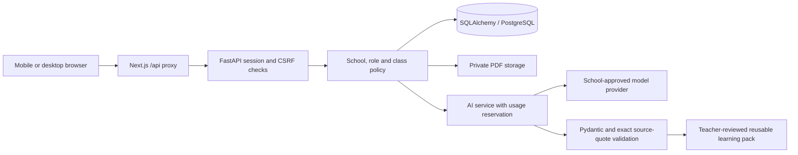
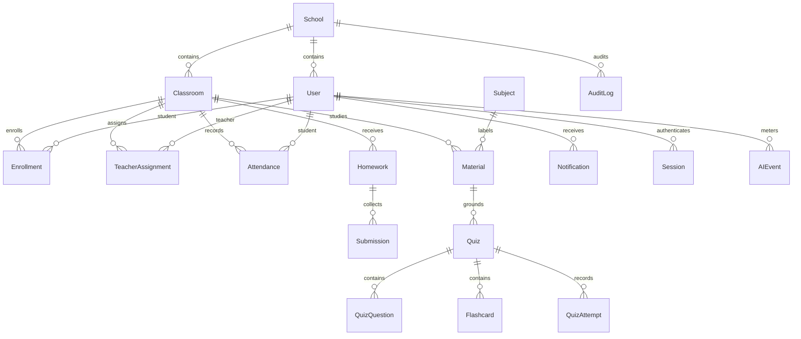

# Architecture and engineering decisions

## One request, end to end

The browser receives a random opaque HttpOnly session cookie. Only its SHA-256 hash is stored in the database. A separate CSRF token is returned to the authenticated page and required on all state-changing requests. Logout deletes the session; password changes revoke every session. Passwords use Argon2 through pwdlib. Production cookies require HTTPS.

Next.js serves the UI and forwards `/api` to FastAPI. This keeps cookies on the frontend origin and API keys outside the browser. The Next rewrite is infrastructure routing, not an authorization boundary. Every backend handler authorizes independently.

FastAPI uses request-scoped SQLAlchemy sessions. Class-related queries use the signed-in user's school and class membership; student submission/attendance queries additionally filter by that student's ID. Pydantic handles input/output contracts. Domain modules are school operations (`routes.py`), notes/homework (`learning.py`), practice/analytics (`arena.py`), and provider integration (`ai.py`). A modular monolith keeps transactions and debugging straightforward without distributed services.

## Relationships

School IDs sit on school-owned entities; child entities inherit scope through their parent. Foreign keys enforce parent existence. Application policy checks tenant and role membership for writes; **the database does not yet use PostgreSQL row-level security or composite tenant foreign keys**. Raw database writes must never bypass policy validation. Unique constraints cover school class names, class membership, teacher assignment, student/date attendance, homework submission and student/day/quiz/mode attempts. Role, grade and attendance status also have database checks. Frequently filtered foreign keys are indexed.

Attendance is an ordinary transaction, not AI. PostgreSQL locks the class row to serialize attendance saves, and version comparison detects stale edits. A unique constraint remains the final duplicate guard. SQLite is suitable for a single-process local demonstration; it does not provide equivalent row locking.

## AI pipeline

1. Authenticate and authorize the selected approved chapter. A student cannot query another class's materials or drafts.
2. Reserve one daily AI request in `AIEvent` under a PostgreSQL user-row lock before contacting a provider. Failures count toward the limit, controlling retry costs.
3. For packs, bound source to 18,000 characters. For tutoring, split the selected chapter at sentence boundaries. PostgreSQL ranks candidate chunks using full-text search (`simple` configuration); SQLite uses lexical overlap. A bounded chapter fallback handles weak lexical matches, including English-source/Hindi questions. No vector service is needed yet.
4. Send only the selected source, grade, language and current question, with a versioned system prompt and Pydantic JSON schema. Account names, email addresses and previous conversations are not added. User-provided text can itself contain personal information, so school procedures and provider contracts still matter.
5. Validate the provider envelope/usage and JSON structure, question kinds, answer-option consistency, distinct options, duplicate questions and supporting quotes. Packs need at least five MCQs, one short answer and two distinct flashcards. Summaries and flashcard backs must use excerpted source sentences. Missing/unsupported evidence fails closed. These checks establish traceability, **not semantic correctness**: a quoted sentence can still be misinterpreted.
6. Record model, prompt version, request outcome, latency and token-based estimated cost. Error records contain exception type, not prompt or provider response bodies. Cost is only accurate if configured token prices match the approved model; zero means an estimate was not configured, not free inference.
7. Store the draft pack, questions and cards. Teachers can edit and publish. Published packs are frozen to preserve attempts. Students reuse saved material, avoiding repeated generation cost.
8. Study Buddy discards unverified model explanations and follow-up claims, then returns an original chapter excerpt with fixed framing/follow-up, or a fixed insufficient-context response. This conservative mode limits newly introduced claims; it does not establish source truth, relevance, grade suitability or correct abstention. Source-language excerpts remain in that language, including for Hindi questions; only framing is localized. It sends no conversation history and Nexora does not store question/answer text. The model provider may retain requests according to its contract.

The provider adapter uses a Chat Completions-compatible endpoint with JSON-object mode. Providers must support this contract; this is not a claim that every model API is compatible. API keys and model names come from backend environment variables. No model is selected or billed automatically.

## Practical limits and failure modes

- Network/API/provider failures produce visible errors; a failed generation is never published. There is no offline write queue or fabricated AI fallback.
- PDF uploads require text-readable, unencrypted PDFs up to 10 MB/100 pages and 60,000 extracted characters. Scanned PDFs need OCR outside this MVP. Invalid signatures are rejected; this is not malware scanning. Production needs isolated parsing and a scanning/quarantine policy.
- Process-local rate limits target a single API replica. A trusted reverse proxy must enforce correct client-IP handling; distributed deployments need a shared limiter. Do not trust arbitrary forwarded headers.
- Class membership is selected at creation in this MVP. Editing enrollments, account deactivation and school subject catalog management need additional admin workflows before broader school operations.
- Written homework submission is supported; homework attachment uploads are not implemented. Optional team results are deferred.
- Basic attendance history is bounded to 1,000 rows and the UI displays the latest 60. Larger exports need pagination/streaming before a full-year school pilot.
- Notifications are stored in-app; upcoming deadlines are derived when opening notifications. No email/SMS delivery or scheduler is running.
- Arena scores are practice feedback, not academic grades or consequential decisions. Repeated class attempts are limited to one per quiz per day. Daily selection rotates among available approved quizzes; results and badges are private.

## Scaling beyond one school

The same schema supports multiple school rows immediately. Start with one API instance, managed PostgreSQL with backups and private S3-compatible storage. Before additional instances, move rate limiting to a shared store and meter usage globally at the provider as well. Add pagination, query profiling and bounded background processing only when measurements justify them. Add vector retrieval only after the evaluation set shows full-text retrieval misses important questions. For higher assurance, add PostgreSQL RLS and composite tenant constraints in a reviewed migration, then run cross-school tests against PostgreSQL too.
